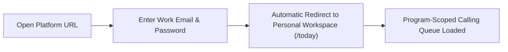
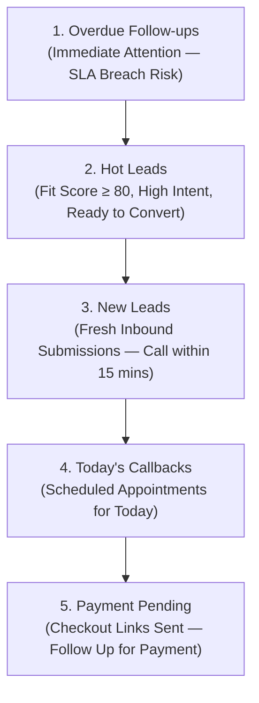
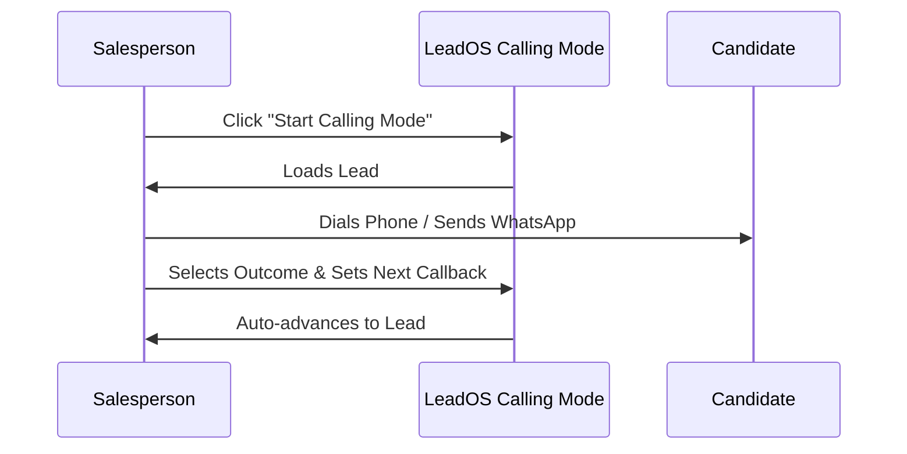

# LeadOS — Sales Representative User Guide & Standard Operating Procedure (SOP)

> **Platform URL:** [https://aivalytics-leados.vercel.app](https://aivalytics-leados.vercel.app)  
> **Direct Workspace Link:** [https://aivalytics-leados.vercel.app/today](https://aivalytics-leados.vercel.app/today)  
> **Target Audience:** Admissions & Growth Team (**Yamin, Hari, Khurram, Jay**)  
> **Version:** 2.4 (Strict Program Scoping & Power Calling Mode)

---

## 1. Quick Start & Login

Every sales representative has an isolated, secure account. Authentication is mandatory; shared links (`/today`) will always prompt for credentials if you are not currently signed in.



### 1.1 Representative Credentials

| Name | Role & Title | Assigned Program Ecosystem | Login Email | Default Password |
| :--- | :--- | :--- | :--- | :--- |
| **Yamin** | Admissions Specialist | **AI-Native Project Management (AI-PM)** | `yameen@aivalytics.io` | `Yamin@123` |
| **Hari** | Admissions & Growth Lead | **3-Day AI Builder Workshop (Free Webinar)** | `hari@aivalytics.io` | `Hari@123` |
| **Khurram** | Career Consultant | **3-Day AI Builder Workshop (Free Webinar)** | `khurram@aivalytics.io` | `Khurram@123` |
| **Jay** | Admissions Executive | **3-Day AI Builder Workshop (Free Webinar)** | `jay@aivalytics.io` | `Jay@123` |

### 1.2 Sign-In Steps
1. Navigate to [https://aivalytics-leados.vercel.app/auth/signin](https://aivalytics-leados.vercel.app/auth/signin).
2. Enter your registered work email and password.
3. Click **Sign in to LeadOS**.
4. You will land directly on your **My Day** workspace (`/today`).

> [!IMPORTANT]
> **Strict Security & Lead Privacy**: As a salesperson, you only see leads assigned specifically to you within your authorized program. System administration tools, global team rosters, and database configurations are restricted to Admin.

---

## 2. Navigating Your Workspace

The salesperson interface is focused solely on high-speed admissions execution:

```
┌─────────────────────────┬────────────────────────────────────────────────────────┐
│  AIValytics LeadOS      │ Top Metrics: Today's Calls | Connect Rate | Revenue     │
├─────────────────────────┼────────────────────────────────────────────────────────┤
│  TODAY                  │ [Priority Action Queue]  [All Assigned Leads]  [Calls] │
│  📅 My Day (/today)     │                                                        │
│                         │  1. Overdue Follow-ups (0)                             │
│  ENABLEMENT             │  2. Hot Leads (High Fit Score ≥ 80)                    │
│  📖 Programs & scripts  │  3. New Leads (<15m Response SLA)                      │
│                         │  4. Today's Callbacks                                  │
│  [👤 Rep Name] [Logout] │  5. Payment Pending                                    │
└─────────────────────────┴────────────────────────────────────────────────────────┘
```

* **My Day (`/today`)**: Your core cockpit containing your daily target metrics, 5 priority queues, full assigned leads directory, and call history.
* **Programs & scripts (`/programs`)**: Pitch scripts, curriculum syllabus links, objection handling playbooks, and webinar replays.
* **Start Calling Mode**: Top-right blue button to enter the full-screen **Power Dialer**.

---

## 3. The 5 Priority Action Queues

On `/today`, your leads are algorithmically categorized into five prioritized queues. Work through them **from top to bottom**:



### Queue Breakdown

1. **Overdue Follow-ups (Red Badge)**:
   * **Why**: Candidates you promised to call back whose scheduled time has passed.
   * **Rule**: Clear all overdue items before 11:00 AM every morning.
2. **Hot Leads (Orange Badge)**:
   * **Why**: High-intent candidates with strong experience and background match (Fit Score $\ge 80$).
   * **Rule**: Pitch cohort admission and 1-on-1 strategy sessions directly.
3. **New Leads (Blue Badge)**:
   * **Why**: Fresh Meta form fills or direct Excel uploads from Admin.
   * **Rule**: Contact within **15 minutes** of submission to maximize conversion.
4. **Today's Callbacks (Slate Badge)**:
   * **Why**: Candidates who asked to be called at a specific time today.
   * **Rule**: Dial within $\pm 5$ minutes of the agreed time.
5. **Payment Pending (Green Badge)**:
   * **Why**: Candidates who agreed to enroll and received a Razorpay checkout link.
   * **Rule**: Assist with credit card/EMI or net banking queries to close the sale.

---

## 4. How to Handle a Lead (Step-by-Step)

### Step 1: Pre-Call Preparation (30 Seconds)
Click **Details** on any lead card to open the **Lead Inspection Panel**:
* Review **Current Role & Experience** (e.g. *Senior Project Lead, 8 yrs*).
* Check **Primary Goal** (e.g. *Transitioning to AI-Native workflows*).
* Read **Ad Creative & Comments** to see what hook made them submit the form.

### Step 2: Placing the Call
* Click the phone number or the **Call** button to initiate the dial on your phone or softphone.
* Use the **Recommended Opening Script** displayed on the screen:
  > *"Hi [Candidate Name], this is [Your Name] from AIValytics. I noticed you submitted an application for our [Program Name] cohort regarding your transition as a [Current Role]. Do you have 3 quick minutes?"*

### Step 3: Fast Qualification & Objection Handling
While speaking, check the **Qualification** tab in the Lead Panel to record:
* **Current AI Usage**: Beginner / Intermediate / Advanced.
* **Timeline**: Immediate / Next Cohort.
* **Budget / Payment Preference**: Full / EMI.
* Use the **Objections** tab if the candidate asks about fee, live vs recorded sessions, or time commitment.

### Step 4: One-Click Quick Logging
Immediately after hanging up, click **Log Call**:
1. Select the **Outcome**:
   * `Connected — Interested`
   * `Connected — Follow-up Needed`
   * `Connected — Payment Pending`
   * `Did Not Pick / Busy`
   * `Unqualified / Not Interested`
2. Enter a short note (e.g. *"Spoke to candidate. Strong background. Sent brochure on WhatsApp. Scheduled callback for tomorrow 3 PM."*).
3. Set the **Next Action Date & Time**.
4. Click **Save Call Log**. The system updates your metrics in real time.

---

## 5. WhatsApp Outreach & Instant Follow-Ups

LeadOS includes pre-formatted WhatsApp templates that open directly in WhatsApp Web with the candidate's phone number pre-filled:

1. Click the **WhatsApp** icon on the lead card.
2. Select your template:
   * **Welcome & Curriculum Brochure**: Sends the syllabus PDF link.
   * **Missed Call Notification**: *"Hi [Name], tried reaching you regarding your AIValytics application..."*
   * **Webinar Confirmation**: Live joining link and schedule for the 3-Day Workshop.
   * **Secure Checkout Link**: Direct link to the Razorpay checkout.
3. Click **Send** in WhatsApp Web.

---

## 6. Power Calling Mode (High-Velocity Outreach)

When you need to make continuous calls (e.g. dialing 20–30 new leads or callbacks), use **Calling Mode**:



1. Click **Start Calling Mode** (top-right of `/today`).
2. The screen switches to a focused, distraction-free dialer.
3. The lead's background, past notes, and phone number appear in high visibility.
4. Click **Dial** or **WhatsApp**.
5. Log your notes in the right sidebar.
6. Click **Next Candidate** or use keyboard shortcut `Ctrl + Enter` to auto-advance.

---

## 7. Generating Payment Links & Closing Admissions

When a candidate agrees to enroll:

1. In the lead panel or quick actions, click **Send Payment Link**.
2. **Program Fees**:
   * **AI-Native Project Management (AI-PM)**: ₹49,999 (Full) or 3-Month No-Cost EMI.
   * **3-Day AI Builder Workshop**: ₹6,999 (or Free Webinar pass).
   * **Upgrade Offer**: Any AI Builder alumni receives a ₹6,999 tuition credit toward AI-PM.
3. Share the Razorpay checkout link via WhatsApp.
4. Update the stage to **Payment Pending**.
5. Once payment completes, the lead updates to **Converted** and revenue is added to your daily progress bar.

---

## 8. Daily Sales Hygiene & Checklist

To maintain pipeline health and conversion rates, every representative must complete this daily checklist before logging out:

- [ ] **Zero Overdue Tasks**: Clear all red overdue callbacks first thing in the morning.
- [ ] **<15 Min New Lead SLA**: Dial every newly assigned inbound lead within 15 minutes.
- [ ] **Next Action Scheduled**: Never leave an active lead without a scheduled next task date.
- [ ] **Call Log Completeness**: Every dial must have an outcome and 1-sentence note logged.
- [ ] **Daily Call Target**: Hit your minimum daily target (25 dials for Hari/Khurram, 30 dials for Yamin/Jay).

---

## 9. FAQs & Troubleshooting

### Q: Why don't I see any leads in my queue?
* Verify you are logged into your correct personal account.
* If you handle AI Native Builder (Hari, Khurram, Jay), you will only receive leads tagged for the 3-Day Builder Workshop. When Admin uploads an Excel batch for your name, they will instantly appear.

### Q: What if I shared my link with someone and they saw a login screen?
* This is intentional. LeadOS enforces strict authentication so unauthorized individuals can never view customer phone numbers or confidential admissions data. Have them log in with their assigned work email and password.

### Q: How do I request more leads?
* Notify Admin Maaz. The admin can assign leads individually, route via automated round-robin, or directly upload an Excel sheet to your profile.

---

*LeadOS Admissions Support • AIValytics India • Build · Learn · Deploy*
